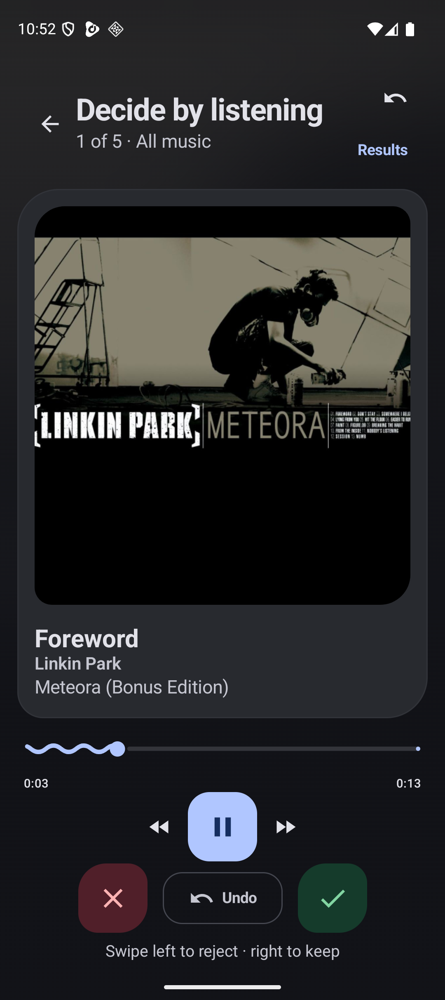
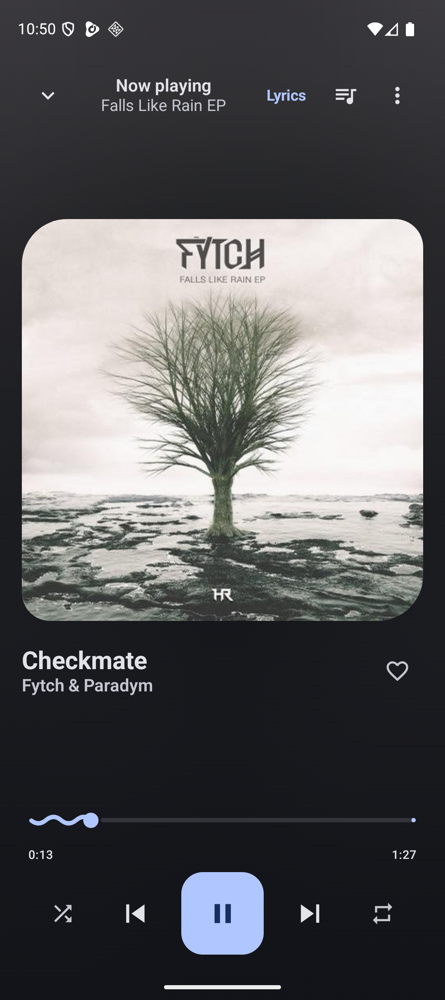
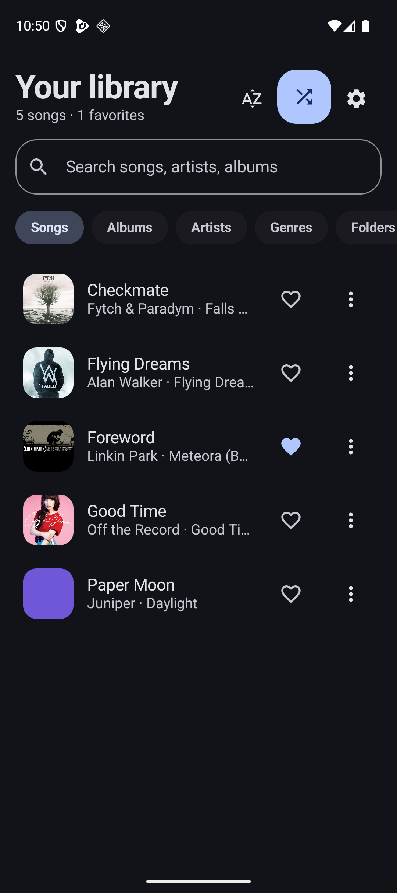

# SwipeTune

<p align="center">
  
</p>

**A complete local music player—with an optional swipe-powered way to clean up your library.**

Listen normally. When your collection needs attention, start Review from Settings, choose all music or one folder, and decide by listening: swipe right to keep a song or left to reject it. Your decisions and place are saved, Undo is always close, and rejected songs stay on your device until you explicitly delete them.

[Download the latest APK](https://github.com/projectescape/swipetune/releases/latest) · [Read the privacy policy](PRIVACY.md)

<p align="center">
  
  
  
</p>

## Why SwipeTune

Most music players help you find something to play. SwipeTune also helps you make sense of the collection you already own—without turning cleanup into the main experience.

- **A real music player first.** Browse songs, albums, artists, genres, folders, favorites, history, and playlists.
- **Review when you choose.** Start it deliberately, scope it to a folder, leave at any time, and continue later.
- **Safe decisions.** Rejecting hides a song inside SwipeTune; it does not delete the file. Restore or permanently delete it later from the Rejected smart playlist.
- **Private by design.** No account, ads, analytics, developer-operated server, or internet permission.
- **Made for Android.** Lock-screen and notification controls, Bluetooth, headsets, Android Auto, dynamic color, a widget, and display-cutout-safe edge-to-edge layouts.

## Player and library

- Local MP3, FLAC, M4A, AAC, WAV, OGG, and other device-compatible audio
- Automatic MediaStore indexing plus optional folders selected through Android's system picker
- Search, sorting, collection playback, shuffle, favorites, history, and persistent playlists
- Full player and mini player with animated seek, previous/next, queue, shuffle, repeat, and favorite controls
- Queue reordering, Play next, append, remove, clear, undo, and save as playlist
- Local synchronized LRC lyrics, sleep timer, ReplayGain, gapless/offload preferences, equalizer, bass boost, and loudness controls
- M3U/M3U8 import and export, portable backup and restore, and Android Auto Backup support
- Duplicate suggestions that keep deletion explicit

## Review mode

- Review all unreviewed music or select one indexed folder
- Swipe right to keep and left to reject
- Undo the previous decision
- Resume the same non-repeating session after leaving or restarting
- Preserve and restore the normal playback queue when entering or leaving Review
- Inspect decisions in non-deletable Accepted and Rejected smart playlists
- Restore rejected songs or permanently delete them after confirmation

## Build

Requirements: JDK 17, Android SDK 37, and Android build tools.

```bash
export ANDROID_HOME=/opt/homebrew/share/android-commandlinetools
mise exec -- ./gradlew lintDebug testDebugUnitTest assembleDebug
```

The debug APK is written to `app/build/outputs/apk/debug/app-debug.apk`.

The Play release uses an upload key kept outside the repository. On the configured release machine:

```bash
./scripts/build-play-release.sh
```

## Documentation

- [Design system](docs/design.md)
- [Implementation notes](docs/internal/implementation-plan.md)
- [Interaction audit](docs/internal/interaction-audit.md)
- [Third-party notices](THIRD_PARTY_NOTICES.md)

## License

SwipeTune is free software licensed under the [GNU General Public License v3.0](LICENSE). It includes Jellyfin's GPLv3 Media3 FFmpeg decoder; source and license details are listed in [THIRD_PARTY_NOTICES.md](THIRD_PARTY_NOTICES.md). The software is provided without warranty.

